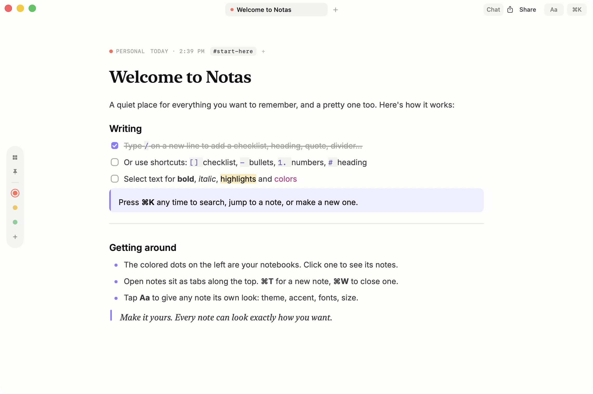
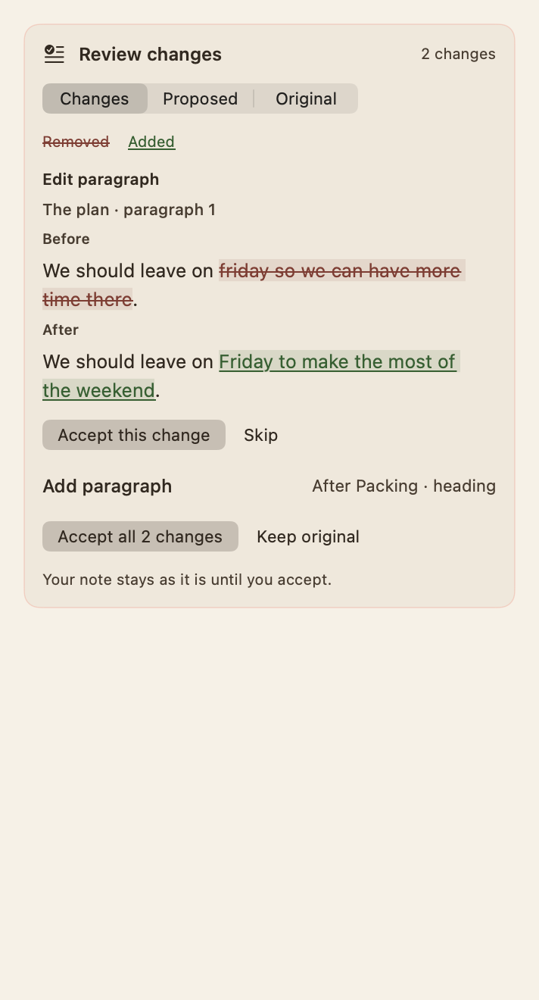
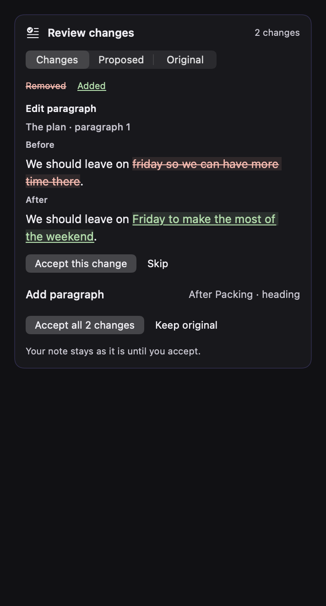

<p align="center">
  
</p>

<h1 align="center">Notas</h1>

<p align="center">A quiet place for your notes. Made for the Mac.</p>

<p align="center">
  <a href="#get-started">Get started</a> ·
  <a href="#a-writing-partner-for-each-note">Note chat</a> ·
  <a href="#keyboard-shortcuts">Shortcuts</a> ·
  <a href="docs/enable-extensions.md">Widgets & sharing</a>
</p>



Write, collect ideas, and keep the details you want to remember. Give each note its own theme, fonts, and accent color. Find notes and commands with **⌘K**, or start writing from anywhere with **⌥Space**.

- Write with headings, checklists, quotes, code, highlights, and text colors.
- Add photos, PDFs, tables, boards, sketches, and text columns.
- Organize notes into notebooks, pin favorites, and keep several notes open in tabs.
- Discuss a note with its assistant, then review suggested edits before accepting them.
- Share a PDF and an editable copy, or keep a favorite note in a desktop widget.

## A writing partner for each note

Click **Chat** or press **⌥⌘J** to ask about the current note. Each note keeps its own conversation, draft, and model choice. Supported Responses models stream their replies and a short reasoning summary into the sidebar.

Review suggested edits with **Before** and **After** previews. Accept one change, skip it, or accept all remaining changes. Your note changes only when you accept, and each acceptance can be undone with **⌘Z**.

<p align="center">
  
  
</p>

Add your **OpenCode API key** in the chat sidebar. Notas stores it in the macOS Keychain. Sending a message shares the current note's text and conversation with OpenCode and the selected model provider. Attachment files stay on your Mac. See [note chat details](design/NOTE_ASSISTANT.md) for model behavior and storage.

## Install

Requires an Apple Silicon Mac on macOS 26. Paste this in Terminal:

```sh
curl -fsSL https://raw.githubusercontent.com/Slopez2023/notas/main/scripts/install.sh | bash
```

It downloads the latest release into `~/Applications` and opens Notas. The release build is not notarized, so the share extension and widgets are not included; build from source with an Apple signing identity for those.

After installing, choose **Notas → Check for Updates…** or use **Check for Updates…** in the menu-bar item. Notas downloads and installs newer tagged releases, then reopens itself.

## Build from source

Requires Apple Silicon, macOS 26, and the Xcode Command Line Tools. Extension signing and installation are covered in [Enable sharing and widgets](docs/enable-extensions.md).

```sh
git clone git@github.com:Slopez2023/notas.git
cd notas
scripts/run.sh
```

To install the latest local build, quit Notas and run:

```sh
scripts/build-app.sh release
python3 scripts/install-app.py
open ~/Applications/Notas.app
```

## Development

```sh
scripts/run.sh                                  # build Notas.app and open it
NOTAS_LIBRARY=/tmp/scratch scripts/run.sh       # use a throwaway library instead of iCloud Drive
scripts/test.sh                                 # codec, editor behavior, storage
scripts/test-assistant.sh                       # assistant checks against a local mock API
scripts/bench.sh                                # release-build timings: load, search, save, editor, photos
scripts/build-app.sh release                    # release build in build/Notas.app
swift scripts/make-icon.swift                   # redraw Resources/AppIcon.icns
```

Notes are stored as files in `iCloud Drive/Notas/` (or `~/Library/Application Support/Notas`
without iCloud Drive): one `Notes/<id>.notas/note.json` per note plus `notebooks.json`.
Deleted notes move to `Trash/` inside that folder.

## Keyboard shortcuts

| Shortcut | Action |
|---|---|
| ⌘N / ⌘T | New note (new tab) |
| ⌘K | Search notes and run any command |
| ⌘W | Close tab |
| ⇧⌘A / ⇧⌘P | All notes / pinned notes |
| ⌥⌘J | Open or close note chat |
| ⌥⌘L | Customize this note's look |
| ⇧⌘S | Share a complete copy of the current note |
| `/` on a new line | Block menu: photos, scan, table, board, columns, sketch, plus text blocks |
| Select text | Format bar: block type, B / I / U / S, code, link, highlighter and text colors |
| `[] ` `- ` `1. ` `# ` `## ` `> ` `! ` ```` ``` ```` | Checklist, bullets, numbers, heading, subheading, quote, callout, code |
| ⌥⌘- | Divider |
| ⌘B ⌘I ⌘U ⇧⌘X ⇧⌘H ⌘E | Bold, italic, underline, strikethrough, highlight, inline code |
| ⌘↩ | Check / uncheck |
| Tab / ⇧Tab, ⌘] / ⌘[ | Indent / outdent list items |

## Power blocks

Use `/` on a body line, the **Insert** menu, or ⌘K to add a block.

- **Photos:** choose images or PDFs, paste an image, or drop files into a gallery. Choose 1–4 photos across. Click a photo for a full-size preview; right-click to reorder or remove it.
- **Tables:** edit cells, use Tab / Shift-Tab to move between them, and Tab past the last cell to add a row. Header controls add rows and columns. Table options toggle the header or remove the last row or column.
- **Boards:** edit column names and cards, add columns or cards, and drag a card by its handle. A card's menu also moves it between columns. **Insert → Turn List into Board** converts the contiguous list at the cursor; checked tasks go to Done.
- **Two columns:** write plain text side by side. Each column scrolls independently. Escape returns to the note.
- **Sketch:** draw with the pen or highlighter, pick a color, or erase whole strokes. Each gesture can be undone with ⌘Z.
- **Scan:** choose **Insert → Scan from iPhone** and select a nearby compatible device. Photos and all pages of scanned PDFs are stored in the note's gallery. Apple Account, Wi-Fi, and Bluetooth requirements follow macOS Continuity Camera.

Photos live in `Notes/<id>.notas/assets/` and copy with blocks between notes. Files remain after removal so Undo can recover them. An untitled note containing a rich block is retained.

For an isolated development session:

```sh
NOTAS_LIBRARY=/tmp/notas-dev NOTAS_DEFAULTS_SUITE=com.stephenlopez.notas.dev scripts/run.sh
```

Implementation decisions and limits are in [design/PHASE3.md](design/PHASE3.md).

## Share a note

Click **Share** in the top-right corner, or press **⇧⌘S**, to open the macOS share popover. Choose AirDrop, Mail, Messages, or another available service.

Each share includes a PDF and an editable `.notasnote` file. The PDF keeps the note's colors, formatting, photos, tables, boards, and sketches for viewing on other devices. Open the `.notasnote` file in Notas to create an independent editable copy with the same appearance and attachments. Later edits stay in each person's own copy.

Tables, boards, and text columns expand in the PDF so scrolling cannot hide content. Editing checklists, cards, cells, and sketches requires Notas. See [Sending complete note copies](design/SHARING.md) for the design and checks.

## Capture from anywhere

Press **⌥Space** for a small quick-note window. The first line becomes the title. Choose a notebook, then press **⌘Return** to save or **⇧⌘Return** to save and open. Escape keeps the draft. The menu-bar icon also opens quick capture and offers another shortcut.

The share extension accepts text, web links, images, and PDFs. The Favorite note widget shows a chosen note or checklist. The Quick note widget opens the capture window. Both extensions require an Apple signing identity before installation.

See [Enable sharing and widgets](docs/enable-extensions.md) for Xcode setup and installation. The build script compiles extension artifacts even when signing is unavailable. [Capture and extensions](design/PHASE4.md) explains storage and retry behavior.

After building, quit Notas and run `python3 scripts/install-app.py`, then open `~/Applications/Notas.app`. Use the installed copy for widgets and shared links. Run `python3 scripts/diagnose-widgets.py` to inspect widget registration.

## Project notes

[Product specification](design/SPEC.md) · [Edit review](design/EDIT_REVIEW.md) · [Sharing](design/SHARING.md) · [Capture and extensions](design/PHASE4.md)

README screenshots use a separate demo library. To regenerate the native review previews:

```sh
NOTAS_REVIEW_PREVIEWS="$PWD/assets/screenshots" scripts/test-assistant.sh
```
